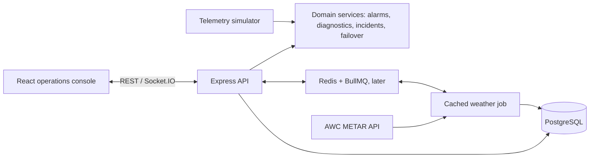

# AeroPulse architecture

## Purpose and boundaries

AeroPulse models 10 logical CNS/support systems. Each system owns two simulated devices: a primary and a standby. It is a software simulation, not an airport integration. Its two data sources must remain visibly distinct:

- **Simulated equipment telemetry** is generated inside the API service every five seconds.
- **Real weather observations** are fetched by the API from the public Aviation Weather Center METAR endpoint and labelled as external observations.

## Target component design

### Why this shape?

The React application only renders data and requests authorised actions. The API owns business rules, permissions and database writes. This makes it impossible to bypass a disabled frontend button by calling an API directly. PostgreSQL holds the durable operational record; Socket.IO distributes fresh updates but is never the source of truth.

The first implementation uses a single API process. Redis, BullMQ, multiple API instances and Nginx are intentionally deferred until the core workflow is tested. Adding distribution too early makes debugging a beginner project much harder.

## Planned domain modules

| Module | Responsibility |
| --- | --- |
| Identity | Users, password hashing, JWT issuance and role-based authorisation |
| Asset registry | Logical systems, devices, operational roles and lifecycle details |
| Telemetry | Five-second readings, heartbeats, retention and real-time events |
| Redundancy | Health evaluation, active/standby assignment, failover and authorised failback |
| Alarm centre | De-duplicated alarms, acknowledgements, missed-alarm recovery and browser notifications |
| Diagnostics | Configurable rule evaluation and suspected root-cause evidence |
| Incidents and maintenance | State transitions, notes, repairs, costs, parts and audit history |
| Analytics | Calculations based solely on recorded events and explicitly labelled demo data |
| Weather | Cached METAR retrieval with timeout, stale-state and error handling |
| Simulation laboratory | Administrator-only fault injection and recovery controls |

## Database design decisions (before implementation)

PostgreSQL is appropriate because this platform needs relationships, transactions, constraints and auditability. Prisma will describe schema and migrations, but database constraints will remain the final guardrail.

| Area | Main tables | Key design decision |
| --- | --- | --- |
| Identity | `users`, `roles` or role enum, `refresh_tokens` (if adopted) | Store only bcrypt password hashes; role checks happen in API middleware. |
| Equipment | `logical_systems`, `devices`, `device_replacements` | A device belongs to one logical system. Its service role (`PRIMARY` / `STANDBY`) is separate from health (`HEALTHY` / `DEGRADED` / `UNAVAILABLE`) and activation state. |
| Measurements | `telemetry_readings`, `heartbeats` | Append-only, timestamped device readings. Index `(device_id, recorded_at DESC)` for charts and diagnosis. Apply an explicit retention policy later. |
| Alarms | `alarms`, `alarm_acknowledgements` | An alarm represents a condition, while acknowledgements are separate immutable user actions. Acknowledgement never changes device health. |
| Operations | `incidents`, `incident_timeline_entries`, `repair_records`, `maintenance_schedules` | The incident state machine and timeline retain how, when and by whom decisions were made. |
| Diagnosis | `fault_diagnostics`, `diagnostic_evidence`, `confirmed_causes` | Preserve suspected diagnosis separately from an engineer's confirmed root cause. |
| Redundancy | `failover_events`, `service_status_history` | Record device downtime and logical-service downtime independently. |
| Recommendations | `replacement_recommendations`, `recommendation_approvals` | Store the policy evidence and supervisor decision, rather than overwriting history. |
| External data | `weather_observations` | Cache METAR payload, observation time, retrieval time and stale/error state. |
| Audit | `audit_logs` | Append actor, action, target, safe metadata and timestamp for sensitive changes. |

Important constraints will include unique system names, unique device identifiers, valid incident transitions enforced in service code, and a transactionally protected single-active-device rule per logical system. PostgreSQL partial unique indexes are a strong option for the latter: only one assignment with `activation_state = 'ACTIVE'` may exist at a time. A failover transaction locks the logical-system row, rechecks backup health, changes assignment, writes the failover event and creates the alarm/incident atomically.

## Core state models

### Device health, role and service availability are different

- **Device health** answers: can this physical/logical device operate? (`HEALTHY`, `DEGRADED`, `UNAVAILABLE`, `RECOVERING`).
- **Operational role** answers: what redundancy role is it assigned? (`PRIMARY`, `STANDBY`).
- **Activation state** answers: is it presently serving traffic? (`ACTIVE`, `STANDBY`, `INELIGIBLE`).
- **Logical service availability** answers: can the logical system provide its intended service? (`AVAILABLE`, `DEGRADED`, `OUTAGE`).

Keeping these separately prevents a common modelling bug: a failed primary does not necessarily mean service is down when a healthy standby is active.

### Incident lifecycle

`DETECTED → ACKNOWLEDGED → ASSIGNED → UNDER_INVESTIGATION → UNDER_REPAIR → VERIFICATION → RESOLVED`

The API permits only valid forward transitions and writes a timeline/audit event for every change. Supervisory approval is required wherever the policy demands it.

## Reliability calculations

Metrics are calculated from persisted timestamps, not placeholders:

- MTBF = operating time divided by number of recorded failures.
- MTTR = total repair duration divided by resolved repair count.
- MTTD = mean of detection time minus actual failure/start time where both are recorded.
- MTTA = mean of first acknowledgement time minus alarm creation time.
- Equipment availability = (period duration − device downtime) / period duration.
- Service availability = (period duration − service outage) / period duration.

Historical demo records will be seeded with an explicit `DEMO` provenance label so the UI never presents demonstrations as observed performance.

## Security baseline

- Validate all incoming API data with Zod.
- Hash passwords with bcrypt; never log passwords, JWTs or refresh tokens.
- Authenticate JWTs and enforce roles on backend routes.
- Use parameterised Prisma queries, rate limiting and security headers.
- Store configuration in environment variables, with only variable names and safe values in `.env.example`.
- Maintain structured, redacted logs and an audit trail for state-changing actions.

## Beginner notes (Hinglish)

**Frontend** browser mein UI dikhata hai. **Backend** rules apply karta hai, jaise “kya engineer alarm acknowledge kar sakta hai?”. **Database** permanent record rakhta hai. Browser REST request se data mangta hai; Socket.IO live update bhejta hai. Agar browser disconnect ho jaaye, reconnect ke baad woh REST se current state aur missed alarms dobara le sakta hai.

**Transaction** ka matlab related database changes ek unit ki tarah honge: failover ka half-result save nahi hoga. **Index** ek book ke index jaisa hai—fast lookup ke liye, especially device history aur time-range charts ke liye.
